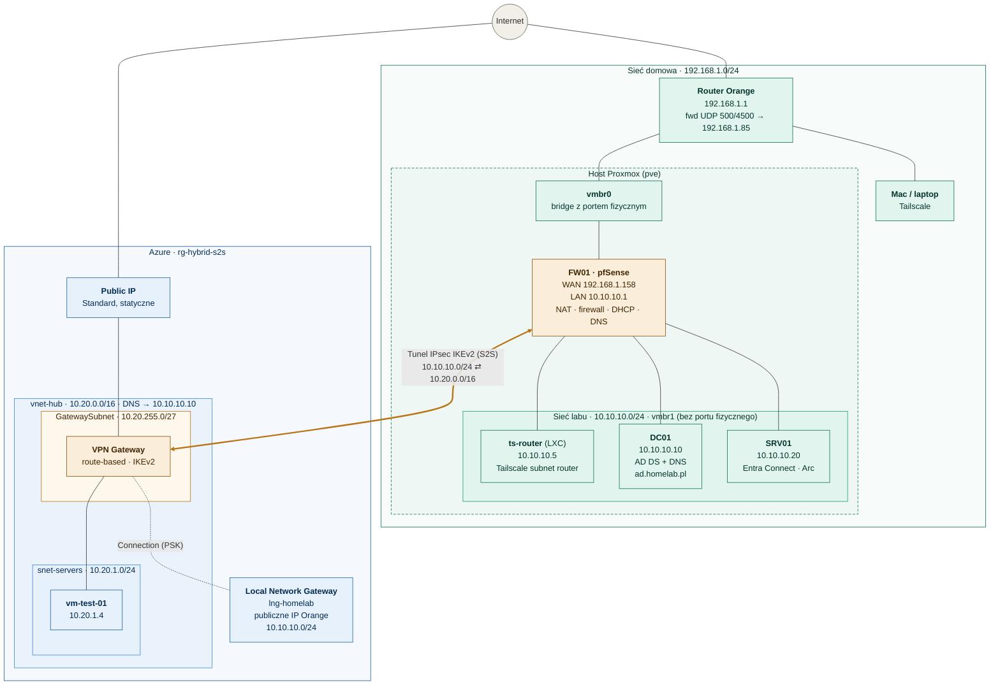
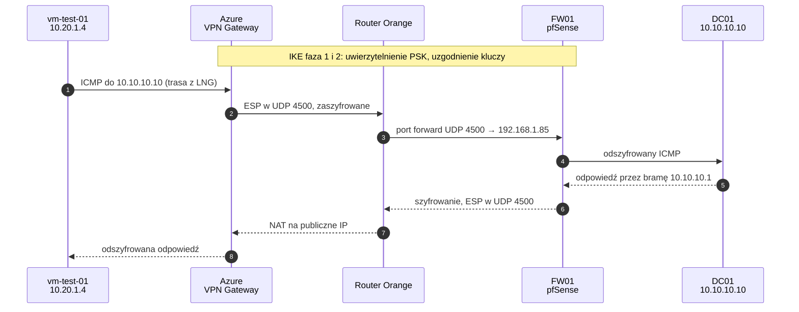

# Hybrid S2S – lab on-prem ↔ Azure

Site-to-site VPN (IPsec IKEv2) łączący domowy lab Active Directory na Proxmoxie z siecią wirtualną w Azure.
Końcem tunelu po stronie on-prem jest pfSense (FW01), po stronie Azure – VPN Gateway.

## Architektura

> Pomarańczowe węzły to dwa końce tunelu. Fizycznie zaszyfrowany ruch idzie przez vmbr0, router Orange (NAT, NAT-T na UDP 4500) i internet – tunel jest połączeniem logicznym nałożonym na tę drogę.

Środowisko domowe jest podzielone na dwie strefy: zwykłą sieć domową oraz całkowicie odizolowaną sieć labolatoryjną
### Warstwa sieci domowej (192.168.1.0/24)
- Router Orange (192.168.1.1/24) - Fizyczny router od dostawcy internetu, pełni on rolę bramy domyślnej dla domu. Posiada publiczny adres IP od operatora. W badanych scenariuszu właściwy firewall labolatoryjnym znajduje się za tym routerem przez co występuje zjawisko tzw. *Double NAT*. Aby pfSens był osiągalny dla połączeń IPsec z Azure, na routerze Orange skonfigurowałem przekierowanie portów na adres WAN pfSense (192.168.1.85):
	- UDP 500 (IKE / Internet Key Exchange)
	- UDP 4500 (NAT-T / NAT-Traversal)
- Laptop (Tailscale) - Stacja roboczo / administracyjna. Postanowiłem użyć klienta Tailscale  który daje bezpieczny dostęp do sieci labu przez **ts-router**, który działa jako subnet router dla 10.10.10.0/24, bez wystawiania jakichkolwiek usług labu do internetu.
### Warstwa wirtualizacji: Host Proxmox
- Fizyczny serwer z zainstalowanym hypervisorem typu 1 Bare-metal (Proxmox VE), na którym działa wirtualny przełącznik sieciowy (Linux Bridges), maszyny wirtualne (VM) oraz kontenery (LXC)
	- **vmbr0 (Bridge z portem fizycznym)** - Wirtualny przełącznik (switch) podpięty jest on bezpośrednio do fizycznej karty sieciowej serwera. Każda maszyna bezpośrednio wpięta do **vmbr0** znajduje się w sieci domowej.
	- **FW01 - pfSense (WAN: 192.168.1.158 | LAN: 10.10.10.1)** - Jest to serce sieciowego labu, pełni rolę routera oraz firewall. Posiada dwie karty sieciowe:
		- Interfejs WAN (192.168.1.85 / vmbr0) - Odbiera ruch z sieci domowej (w tym IPsec z Azure)
		- Interfejs LAN (10.10.10.1 / vmbr1) - Stanowi bramę domyślną dla wszystkich serwerów w labie.
		- Rola w środowisku - Odpowiada za NAT, Firewall (kontroluje ruch między domem, labem a Azure), serwer DHCP, lokalny serwer DNS oraz końcowy punkt tunelu IPsec IKEv2 który odpowiada za połączenie Site-to-Site z bramą w Azure (S2S VPN).
	- **vmbr1 (Switch wewnętrzny / sieć labu)** - Wewnętrzny, wirtualny przełącznik. Nie ma żadnej podpiętej żadnej karty sieciowej. Oznacza to że ruch z sieci 10.0.0.0/24 nie ma innej drogi niż przez FW01.

### Serwery wewnątrz labu (10.10.10.0/24)###
- **DC01 (10.10.10.10 - Windows Server 2022)** - Główny kontroler domeny (Active Directory Domain Services - AD DS) oraz autorytatywny serwer DNS dla lokalnej domeny ad.chaberkamil.org. Odpowiada za uwierzytelnienie użytkowników i komputerów (Kerberos), polityki grupowe (GPO) oraz rozwiązywanie nazw domenowych zarówno dla maszyn w Proxmox, jak i maszyn w chmurze Azure.
- **SRV01 (10.10.10.20 - Windows Server 2022)** - Serwer członkowski (Member Server) w domenie ad.chaberkamil.org, działają na nim usługi integracji hybrydowej.
	- Microsoft Entra Connect - Narzędzie synchronizujące konta użytkowników, grupy oraz skróty haseł (Passwrod Hash Sync) z lokalnego Active Directory do chmurowego katalogu Microsoft Entra ID. Wydzielenie Entra Connect na osobny serwer, to krok podjęty w celu maksymalizacji bezpieczeństwa (izolacja zasobów Tier 0)
	- Azure Arc - Agent zainstalowany na serwerze lokalnym który umożliwi zarządzanie zasobem z poziomu portalu Azure.

### Środowisko chmurowe
- Wszystkie zasoby chmurowe po stronie chmury znajdują się w jednej grupie zasobów (Resource Group), co pozwala na ich logiczne pogrupowanie i łatwe zarządzanie kosztami i cyklem życia.
	- vnet-hub (10.20.0.0/16) - Główna sieć wirtualna (Virtual Network) w Azure zaprojektowana w architekturze Hub.
		- DNS -> 10.10.10.10 - Domyślny serwer DNS vnet-hub został nadpisany adresem lokalnego kontrolera domeny (10.10.10.10). Dzięki temu każda maszyna wirtualna uruchomiona w Azure wysyła zapytania DNS przez tunel VPN prosto do serwera lokalnego DC01, co pozwalaleźć domenę i do niej dołączyć.
	- GatewaySubnet (10.20.255.0/27) - Specjalna podsieć wymagana przez architekturę Azure. Służy ona wyłącznie do hostowania wyłącznie instancji bramy VPN Gateway. 
	- VPN Gateway (route-based | IKEv2) - Zarządzana usługa bramy VPN po stronie Azure:
		- Route-based (oparta na trasa) - Wykorzystuje dynamiczne trasy routingu (wirtualne interfejsy tunelowe VTI, tzw. any-to-any / 0.0.0.0/0 traffic selectors w Fazie 2 IPsec). Jest znacznie bardziej elastyczna i nowoczesna niż starsze bramy typu policy-based.
		- IKEv2 - Nowoczesny i szybki standard negocjacji tunelu IPsec
	- Public IP (statyczny) - Zasób statycznego publicznego adresu IP przypisanego do VPN Gateway. Na ten adres mój domowy wirtualny router (FW01) wysyła zaszyfrowane pakiety.
	- Local Network Gateway (lng-homelab) - Obiekt logiczny w Azure reprezentujący moją sieć lokalną, wewnątrz niego definiuje dwie informację:
		- Publiczne IP routera ISP - adres pod który Azure ma szukać mojego pfSense (FW01)
		- Przestrzeń adresowa lab (10.10.10.0/24) - informację dla routera Azure, że każdy pakiet zaadresowany na tą sieć ma trafić do tunelu IPsec
	- Connection (PSK) - Zasób w Azure łączący logicznie VPN Gateway z Local Network Gateway. Wykorzystuje PSK (Pre-Shared Key) klucz do wzajemnego uwierzytelniania dwóch stron połączenia.
	- snet-servers (10.20.1.0/24) oraz vm-test-01 (10.20.1.4) - Podsieć produkcyjna/serwerowa w chmurze oraz uruchomiona w niej maszyna wirtualna (10.20.1.4), która służy do testowania łączności hybrydowej, oraz dołączenia maszyny chmurowej do lokalnej domeny AD.
	

## Adresacja

| Sieć | Zakres | Gdzie |
|---|---|---|
| Dom (WAN pfSense) | 192.168.1.0/24 | vmbr0 |
| LAN labu | 10.10.10.0/24 | vmbr1 |
| Azure VNet | 10.20.0.0/16 | vnet-hub |
| Azure snet-servers | 10.20.1.0/24 | vnet-hub |
| Azure GatewaySubnet | 10.20.255.0/27 | vnet-hub |

| Host | Adres | Rola |
|---|---|---|
| FW01 | 10.10.10.1 / 192.168.1.85 | pfSense: router, NAT, firewall, DHCP, DNS resolver, koniec tunelu S2S |
| ts-router | 10.10.10.5 | LXC Debian 12, Tailscale subnet router |
| DC01 | 10.10.10.10 | AD DS + DNS (ad.homelab.pl) |
| SRV01 | 10.10.10.20 | Entra Connect, agent Arc |
| DHCP | 10.10.10.100–199 | klienci |
| vm-test-01 | 10.20.1.4 | VM testowa w Azure |

## Przepływ pakietu

[ukryte]