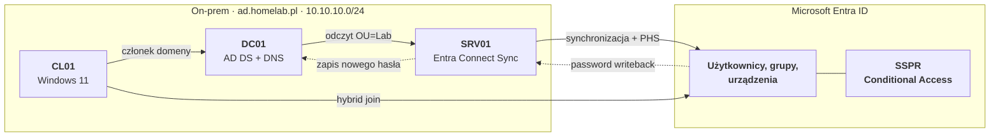
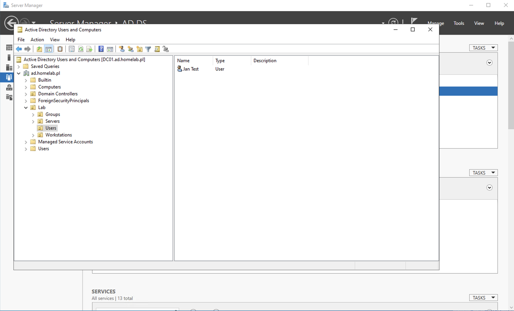
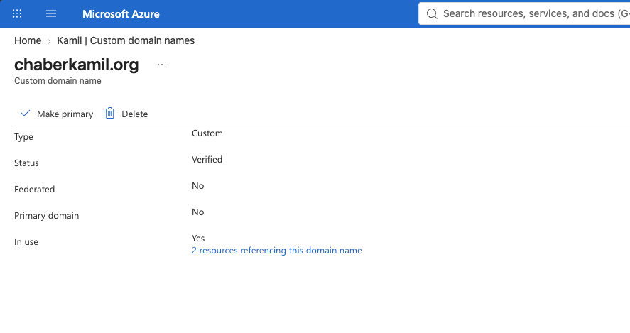
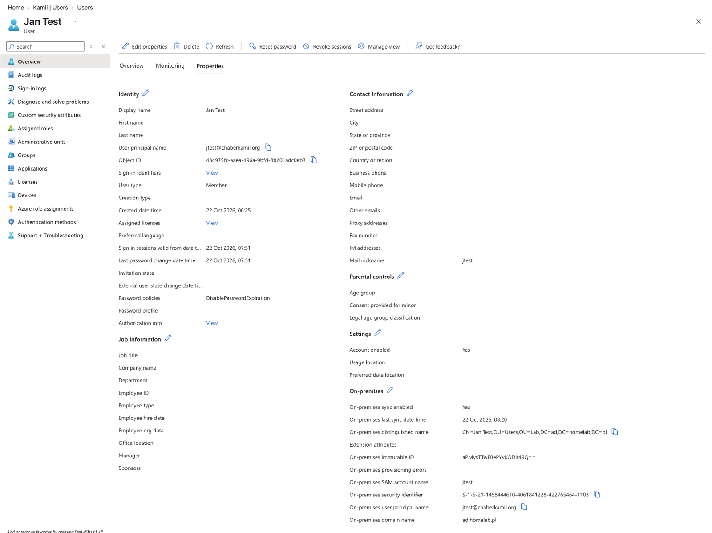
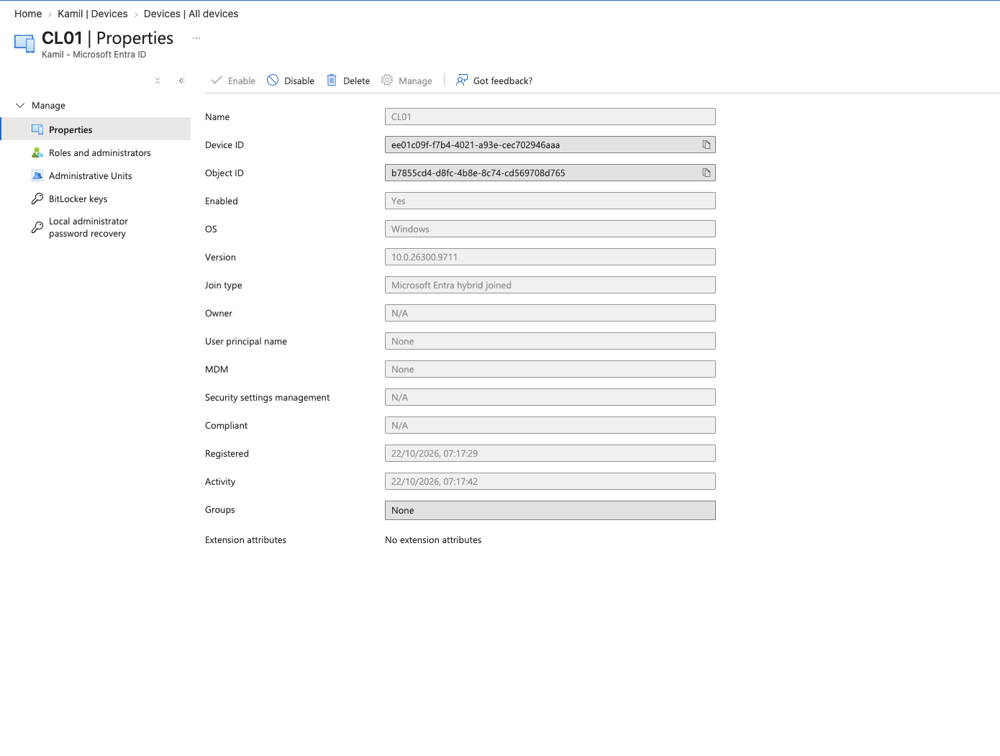
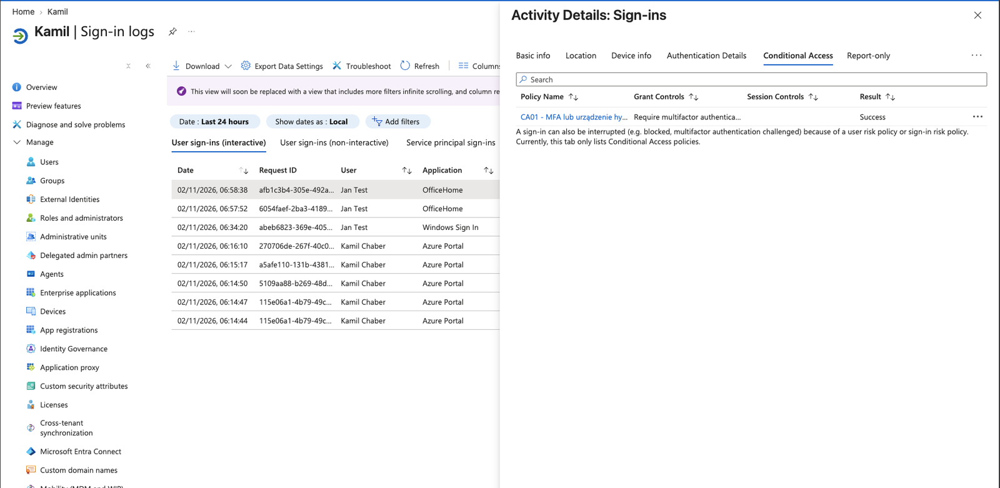

# Etap 1: Tożsamość hybrydowa (AD ↔ Microsoft Entra ID)

## Cel

Odtworzenie typowego środowiska hybrydowego z firmy: użytkownicy i komputery zarządzani w lokalnym Active Directory, a logowanie do usług chmurowych, reset haseł i polityki dostępu obsługiwane przez Microsoft Entra ID. Jedna tożsamość użytkownika działa zarówno lokalnie, jak i w chmurze.

## Architektura



| Komponent | Adres | Rola |
|---|---|---|
| DC01 | 10.10.10.10 | Kontroler domeny `ad.homelab.pl`, DNS |
| SRV01 | 10.10.10.20 | Serwer członkowski, Microsoft Entra Connect Sync |
| CL01 | DHCP (10.10.10.100–199) | Klient Windows 11, hybrid joined |
| Entra ID | – | Tenant z domeną `chaberkamil.org`, licencje Entra ID P2 (trial) |

## Co zostało zbudowane

### Active Directory
- Domena `ad.homelab.pl` na DC01 (AD DS + zintegrowany DNS)
- Struktura OU: `OU=Lab` → `Users`, `Groups`, `Servers`, `Workstations`
- Dodatkowy sufiks UPN `chaberkamil.org` – użytkownicy logują się jako `jan@chaberkamil.org`


*Struktura jednostek organizacyjnych labu.*

### Microsoft Entra ID

Domena `chaberkamil.org` dodana i zweryfikowana (rekord TXT w Cloudflare)


*Domena chaberkamil.org w stanie Verified.*

### Microsoft Entra Connect Sync (SRV01)
- Metoda logowania: **Password Hash Synchronization**
- Filtrowanie: synchronizowana tylko `OU=Lab`
- **Password writeback** włączony
- Seamless SSO: wyłączone


*Konfiguracja z kreatora: PHS, filtrowanie OU, password writeback.*

### Hybrid join
CL01 dołączony do domeny i zarejestrowany w Entra ID jako *Microsoft Entra hybrid joined*
	- Aby było możliwe automatyczne rejestrowanie urządzeń jako *Microsoft Entra hybrid joined* konieczne było skonfigurowanie specjalnego obiektu SCP (Service Cinnection Point) w lokalnej partycji konfiguracji Active Directory, w tym celu na serwerze SRV01 uruchomiono ponownie Microsoft Entra Connect i wybrano zadanie *Configure device options*. W sekcji konfiguracji SCP wskazano las `ad.homelab.pl`. Kreator stworzył odpowiedni obiekt w Active Directory
### Conditional Access
- Polityka dopuszcza logowanie z *zaufanego urządzenia (hybrid joined)* bez dodatkowych kroków, a z każdego innego urządzenia wymaga *uwierzytelnienia weloskładnikowego (MFA)*

## Weryfikacja

| # | Co sprawdzam | Jak | Wynik |
|---|---|---|---|
| 1 | Synchronizacja działa | Entra admin center → Entra Connect → Connect Sync | Sync *Enabled*, PHS *Enabled* |
| 2 | Użytkownik pochodzi z AD i z właściwego OU | Właściwości użytkownika → sekcja On-premises | `On-premises sync enabled: Yes`, DN w `OU=Lab` |
| 3 | CL01 jest hybrid joined | `dsregcmd /status` na CL01 | `AzureAdJoined: YES`, `DomainJoined: YES` |
| 4 | Urządzenie widoczne w Entra | Entra → Devices | Join type: *Microsoft Entra hybrid joined* |
| 5 | SSPR zapisuje hasło do AD | Reset przez `aka.ms/sspr`, potem `Get-ADUser` | `PasswordLastSet` = czas resetu w chmurze |
| 6 | Conditional Access działa | Logowanie w trybie incognito + Sign-in logs | Wymuszone MFA, polityka *Success* |


*Test 1: synchronizacja włączona, metoda logowania Password Hash Sync.*


*Test 2: użytkownik z OU=Lab w domenie ad.homelab.pl, UPN z sufiksem chaberkamil.org.*


*Test 3: CL01 jednocześnie w domenie i w Entra ID.*


*Test 4: CL01 jako Microsoft Entra hybrid joined.*

```powershell

Get-ADUser jtest -Properties PasswordLastSet | Select Name, PasswordLastSet
```

```Powershell
Name     PasswordLastSet
----     ---------------
Jan Test 11/2/2026 6:20:29 AM
```
*Test 5: na DC01, po resecie hasła przez SSPR*


*Test 6: polityka Conditional Access zastosowana przy logowaniu, wymuszone MFA.*

## Decyzje projektowe

#### Password Hash Sync jako metoda logowania ####

- Dlaczego: jest to najprostrza i najbardziej odporna metoda polegająca na zapisywaniu hashy haseł zapewniając bezpieczeństwo i niezawodność. Metoda ta działa nawet wtedy gdy serwer on-prem jest niedostępny, ponieważ sam skrót hasła zapisywany jest bezpośrednio w chmurze Azure.
#### Synchronizacja tylko `OU=Lab`####

- Dlaczego: Do chmury trafia tylko to co nam jest faktycznie potrzebne - użytkownicy, grupy i komputery. Synchronizacja całej domeny jest prostsza ale przenosi do Entra ID obiekty które nie mają tam zastosowania. 
#### Sufiks UPN `chaberkamil.org` ####

- Dlaczego: Entra ID akceptuje jako login tylko domenę zweryfikowaną w tenancie. `ad.homelab.pl` nie jest moją domeną więc, nie da się jej zweryfikować. Dodatkowy sufiks UPN sprawia, że użytkownik ma jeden login AD i w chmurze: `jtest@chaberkamil.org`

#### Seamless SSO wyłączone ####

- Dlaczego: na urządzeniu *hybrid joined* z Windows 11 logowanie jednokrotne zapewnia *Primary Refresh Token* (PRT). Przy logowaniu do Windows komponent CloudAP uwierzytelnia użytkownika w Entra ID i pobiera token PRT, a *Web Account Manager* używa go do wydawania tokenów aplikacjom - aplikacje MS 365 - bez ponownego podawania hasła. Seamless SSO duplikowało by tą funkcję.

#### Conditional Acces: MFA lub urządzenie hybrid joined ####

- Dlaczego: kompromis między wygodą a bezpieczeństwem. Komputer firmowy jest zaufany i zarządzany. Z nieznanych urządzeń wymagane jest MFA.

## Problemy i rozwiązania

### Problem 1: *CL01 nie pojawia się w Entra ID mimo synchronizacji OU* ###
- **Objaw:** CL01 jest w synchronizowanej `OU=Workstations,OU=Lab`, ale w *Entra -> Devices* nie ma żadnego urządzenia. Obiekt komputera w AD nie ma certyfikatu (`userCertificate` – 0 wpisów).
- **Przyczyna:** hybrid joined nie był skonfigurowany - w AD brakowało Service Connection Point (SCP). Bez tego komputer nie wiem do którego tenanta ma się rejestrować więc generuje certyfikatu i nie zapisuje go w atrybucie `userCertificate`. Reguła synchronizacji esportuje urządzenia z kontrolera domeny tylko z wypełnionym atrybutem - skoro CL01 nie miał certyfikatu to mimo odpowiedniego zakresu synchronizacji on sam się nie synchronizował
- **Rozwiązanie:** konfiguracja hybrid joined w kreatorze Entra Connect na SV01, stworzenie samego SCP nie było wystarczające, atrybut `userCertificate` dalej miał 0 wpisów, ponieważ CL01 odczytuje SCP przy uruchomieniu zadania *Automatic-Device-Join* (reset komputera lub relogin)
- **Wniosek:** sama synchronizacja OU nie wystarcza konieczne jest odpowiednia rejestracja samego urządzenia, konfiguracja lokalnego serwera z kontrolerem domeny oraz serwera synchronizującego co pokazuje złożoną zależność rozwiązania.

### Problem 2: *`error_missing_device` przy rejestracji urządzenia*
- **Objaw:** `dsregcmd /status` pokazuje `AzureAdJoined : NO`, a w *Diagnostic Data*: `Registration Type: fallback_sync`, `Server ErrorSubCode: error_missing_device`, *device object … is not found*. W Entra urządzenie ma stan *Pending*.
- **Przyczyna:**
- **Rozwiązanie:**
- **Wniosek:**

## Ograniczenia

- Domena AD `ad.homelab.pl` nie należy do mnie – dobra praktyka to subdomena domeny posiadanej (np. `ad.chaberkamil.org`). Do poprawy przy odbudowie labu jako kod.
- Jeden kontroler domeny – brak redundancji.
- Jeden serwer Entra Connect – brak serwera w trybie staging.
- Całość działa na jednym hoście Proxmox.
- Licencje Entra ID P2 w wersji próbnej.

## Co dalej

- **Etap 2:** połączenie labu z Azure tunelem site-to-site → [02-s2s.md](02-s2s.md)
- **Etap 3:** odbudowa labu jako kod (Terraform + Ansible) z domeną `ad.chaberkamil.org`
