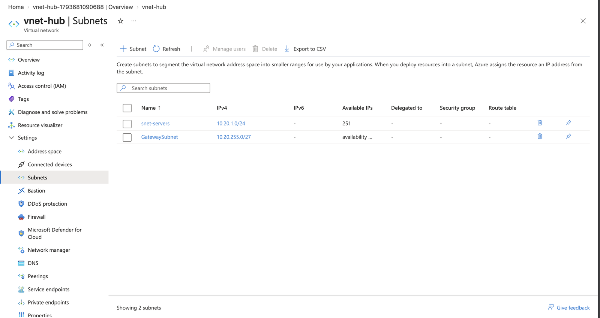
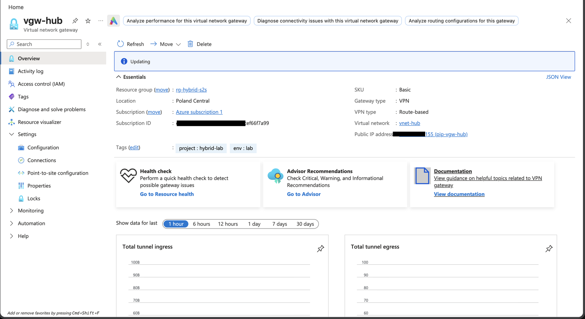
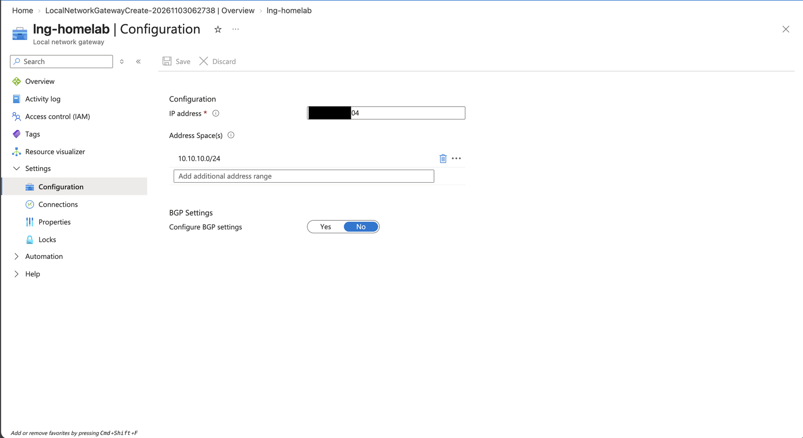
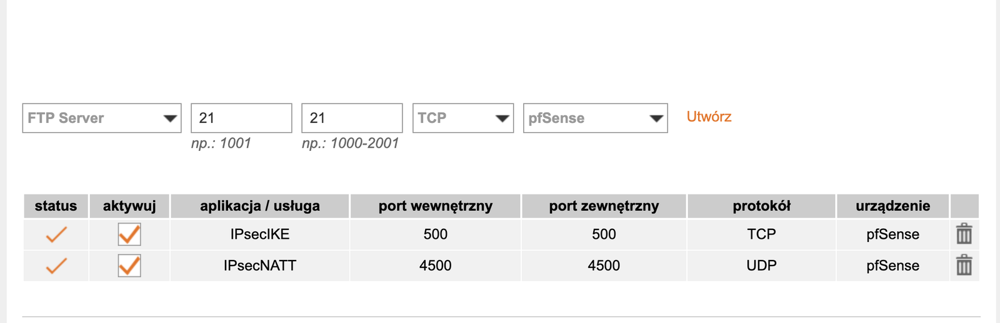
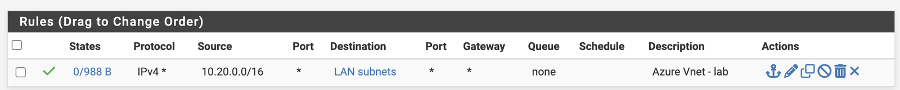
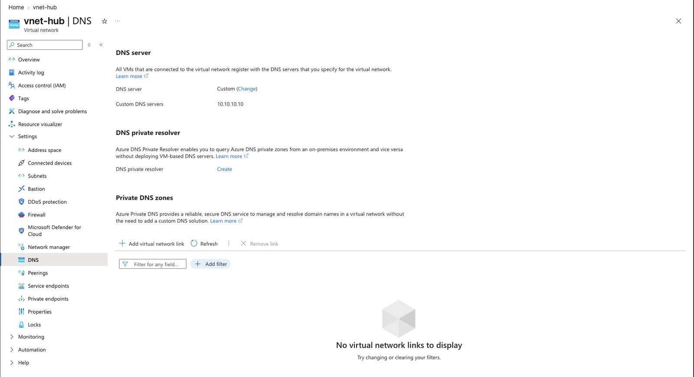
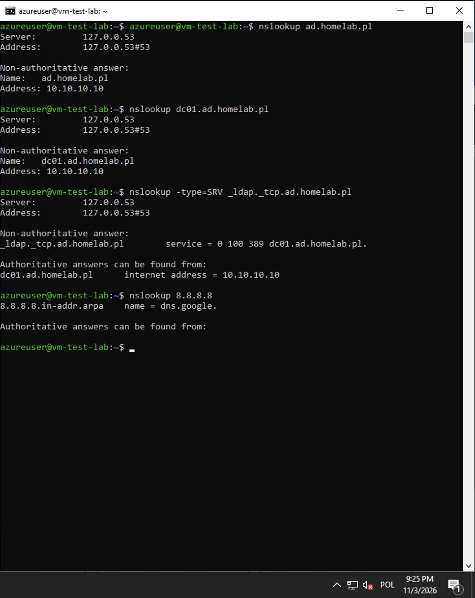
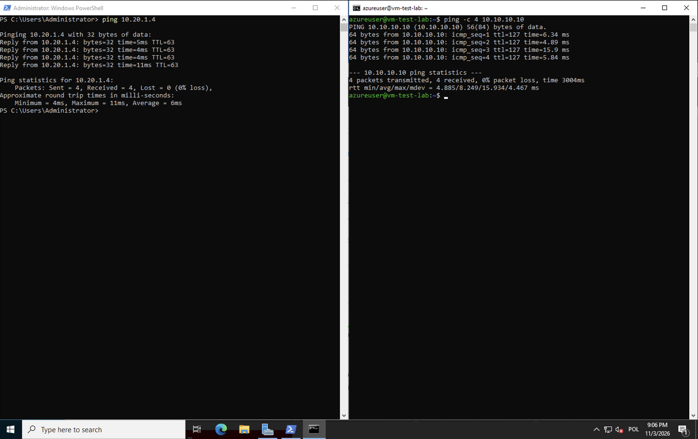

# Etap 2: Tunel site-to-site (lab on-prem <-> Azure)

## Cel

Połączenie sieci labu on-prem (`10.10.10.0/24`) z siecią wirtualną w Azure (`10.20.0.0/16`) szyfrowanym tunelem IPsec. Maszyna w Azure ma widzieć kontroler domeny po prywatnym adresie i dołączyć do domeny `ad.homelab.pl` – bez wystawiania jakichkolwiek usług labu do internetu.

### Adresacja

| Sieć             | Zakres         | Gdzie                |
| ---------------- | -------------- | -------------------- |
| Dom              | 192.168.1.0/24 | router Orange, vmbr0 |
| Lab              | 10.10.10.0/24  | vmbr1, za FW01       |
| Azure VNet       | 10.20.0.0/16   | `vnet-hub`           |
| Serwery w Azure  | 10.20.1.0/24   | `snet-servers`       |
| Podsieć gatewaya | 10.20.255.0/27 | `GatewaySubnet`      |

## Budowa

### Krok 0: przygotowanie

- Publiczny IPv4 od Orange potwierdzony – adres WAN routera zgodny z `curl -4 ifconfig.me` (brak CGNAT).
- Rezerwacja DHCP w Pi-hole dla karty WAN FW01 (`192.168.1.158`) – stały adres, na który wskazuje przekierowanie portów.

### Krok 1: grupa zasobów

Kontener na wszystkie zasoby projektu – usunięcie grupy usuwa cały etap.

- Nazwa: `rg-hybrid-s2s`
- Region: Poland Central
- Tagi: `project=hybrid-lab`, `env=lab`

### Krok 2: sieć wirtualna

Prywatna sieć w Azure, podzielona na podsieć dla maszyn i podsieć dla bramy VPN.
- `vnet-hub`: `10.20.0.0/16`
- `snet-servers`: `10.20.1.0/24` – maszyny wirtualne
- `GatewaySubnet`: `10.20.255.0/27` – zarezerwowana nazwa, bez NSG
- Bastion, Azure Firewall i DDoS Protection wyłączone (koszty; rolę firewalla pełni pfSense)

```bash
az network vnet create -g rg-hybrid-s2s -n vnet-hub -l polandcentral \
  --address-prefixes 10.20.0.0/16 \
  --subnet-name snet-servers \
  --subnet-prefixes 10.20.1.0/24 \
  --tags project=hybrid-lab env=lab

az network vnet subnet create -g rg-hybrid-s2s --vnet-name vnet-hub \
  -n GatewaySubnet --address-prefixes 10.20.255.0/27
```


*Sieć `vnet-hub` z podsieciami `snet-servers` i `GatewaySubnet`.*

### Krok 3: publiczne IP i VPN Gateway

Brama VPN po stronie Azure z publicznym adresem IP, z którym łączy się pfSense. Gatewaya w SKU Basic nie da się utworzyć z portalu – tylko przez Azure CLI lub PowerShell.

```bash
RG=rg-hybrid-s2s
VNET=vnet-hub
LOC=$(az network vnet show -g $RG -n $VNET --query location -o tsv)

az network public-ip create -g $RG -n pip-vgw-hub -l $LOC \
  --sku Standard --allocation-method Static --zone 1 2 3 \
  --tags project=hybrid-lab env=lab

az network vnet-gateway create -g $RG -n vgw-hub -l $LOC \
  --vnet $VNET --public-ip-addresses pip-vgw-hub \
  --gateway-type Vpn --vpn-type RouteBased --sku Basic \
  --tags project=hybrid-lab env=lab --no-wait
```


*Brama `vgw-hub` (Basic, route-based) po utworzeniu.*

### Krok 4: Local Network Gateway

Opis drugiej strony tunelu w Azure: publiczny adres IP domu i sieci za nim. Na tej podstawie Azure kieruje ruch do sieci labu przez bramę.

- `lng-homelab`, endpoint: publiczny adres IP domu
- Przestrzeń adresów: `10.10.10.0/24`
- BGP: wyłączony (Basic SKU nie obsługuje BGP – routing statyczny)

```bash
az network local-gateway create -g rg-hybrid-s2s -n lng-homelab -l polandcentral \
  --gateway-ip-address <publiczne_IP_domu> \
  --local-address-prefixes 10.10.10.0/24
```


*`lng-homelab`: publiczny adres domu (zamaskowany) i przestrzeń adresowa labu.*

### Krok 5: przekierowanie portów na routerze Orange

pfSense znajduje się za domowym routerem Orange, przez co występuje podwójny NAT. Ruch IPsec musi zostać przekierowany na interfejs WAN pfSense (`192.168.1.158`).

| Port | Protokół | Cel      | Do czego                    |
| ---- | -------- | -------- | --------------------------- |
| 500  | UDP      | WAN FW01 | IKE - negocjacje połączenia |
| 4500 | UDP      | WAN FW01 | NAT-T - ESP opakowany w UDP |


*Przekierowanie portów IPsec na routerze Orange.*

### Krok 6: IPsec w pfSense (faza 1 i faza 2)

Gateway Basic nie obsługuje własnych polityk IPsec/IKE, więc pfSense dopasowano do domyślnych propozycji Azure.

#### Faza 1

| Parametr             | Wartość                                                |
| -------------------- | ------------------------------------------------------ |
| IKE                  | IKEv2                                                  |
| Interfejs            | WAN                                                    |
| Uwierzytelnianie     | Mutual PSK                                             |
| My identifier        | publiczny IP domu (pfSense jest za NAT-em)             |
| Propozycje           | AES256 / SHA256 / DH14, zapasowo AES256 / SHA256 / DH2 |
| Lifetime             | 28 800 s                                               |
| NAT-T / DPD / MOBIKE | Auto / włączone / wyłączone                            |

#### Faza 2

| Parametr     | Wartość                                            |
| ------------ | -------------------------------------------------- |
| Tryb         | Tunnel IPv4                                        |
| Sieci        | 10.10.10.0/24 ⇄ 10.20.0.0/16                       |
| Protokół     | ESP                                                |
| Szyfrowanie  | AES256-GCM (128), AES256                           |
| Hash         | SHA256                                             |
| PFS          | wyłączone (Azure jako inicjator nie proponuje PFS) |
| Lifetime     | 27 000 s                                           |


*Konfiguracja fazy 1 i fazy 2 w pfSense.*

### Krok 7: połączenie (Connection) w Azure

Wiąże gateway z Local Network Gateway i definiuje parametry tunelu.
- `conn-homelab`: Site-to-site (IPsec), IKEv2, PSK
- Polityka IPsec/IKE: domyślna (Basic nie obsługuje własnych polityk)
- BGP i policy-based traffic selectors: wyłączone


*`conn-homelab` w stanie Connected.*

### Krok 8: reguły firewalla w pfSense

Zestawiony tunel nie oznacza jeszcze przepływu ruchu. pfSense domyślnie blokuje wszystko, co przychodzi na interfejsie IPsec, więc ruch z Azure do labu wymaga osobnej reguły.

| Interfejs | Akcja | Źródło | Cel | Protokół | Cel reguły |
|---|---|---|---|---|---|
| IPsec | Pass | `10.20.0.0/16` | LAN subnets | any | ruch z Azure do labu |
| LAN | Pass | LAN subnets | any | any | domyślna reguła – ruch z labu do Azure |

Reguła IPsec ma na razie protokół *any*, żeby najpierw potwierdzić łączność. Docelowo zostanie zawężona do ruchu potrzebnego Active Directory, wyłącznie do DC01 (`10.10.10.10`).


*Reguła `10.20.0.0/16` → LAN subnets; licznik stanów pokazuje ruch z Azure.*

Dodatkowo włączone **MSS clamping** na ruchu VPN (*System → Advanced → Firewall & NAT → Enable MSS clamping on VPN traffic*, wartość **1350**, zgodnie z zaleceniem Microsoftu dla tuneli do Azure). Narzut nagłówków IPsec zmniejsza dostępne MTU; bez clampingu mały ping przechodzi, ale większe pakiety TCP (RDP, SMB, LDAP) mogą ginąć.

### Krok 9: maszyna testowa w Azure

- `vm-test-lab`, Ubuntu 24.04 LTS, podsieć `snet-servers`, adres `10.20.1.4`
- **Brak publicznego IP** – maszyna jest osiągalna wyłącznie przez tunel
- Logowanie hasłem (umożliwia awaryjny dostęp przez Serial Console)
- NSG: SSH (22) przychodzące; domyślna reguła `AllowVnetInBound` obejmuje też sieci on-prem za gatewayem

### Krok 10: DNS przez tunel

- DNS sieci `vnet-hub` ustawiony na `10.10.10.10` (DC01) – maszyny w Azure rozwiązują nazwy domeny przez tunel
- Po zmianie DNS maszyna musi odnowić dzierżawę DHCP: `sudo networkctl renew eth0`
- DC01 przekazuje zapytania o nazwy z internetu dalej (forwarder), więc maszyna w Azure ma pełne rozwiązywanie nazw


*Niestandardowy serwer DNS `10.10.10.10` (DC01) dla sieci `vnet-hub`.*

```bash
nslookup ad.homelab.pl
nslookup -type=SRV _ldap._tcp.ad.homelab.pl
```

Rekord SRV `_ldap._tcp` wskazuje `dc01.ad.homelab.pl:389` – po nim klienci domeny odnajdują kontroler.


*Test 6: rekordy A i SRV domeny `ad.homelab.pl` rozwiązywane z `vm-test-lab` przez tunel.*

Dołączenie `vm-test-lab` do domeny przeniesione do etapu 3 – zob. problem 5.

## Weryfikacja

| # | Co sprawdzam | Jak | Wynik |
|---|---|---|---|
| 1 | Tunel zestawiony (faza 1) | pfSense: *Status → IPsec* | *Established*, IKEv2, AES_CBC 256 / SHA256 / MODP_1024 |
| 2 | Faza 2 zainstalowana | pfSense: *Show child SA entries* | 10.10.10.0/24 ⇄ 10.20.0.0/16, AES_GCM_16 (256) |
| 3 | Połączenie po stronie Azure | Portal: `conn-homelab` | *Connected* |
| 4 | Lab → Azure | `ping 10.20.1.4` i `ssh azureuser@10.20.1.4` z DC01 | odpowiedzi, TTL 63 (jeden hop: pfSense) |
| 5 | Azure → lab | `ping 10.10.10.10` z `vm-test-lab` | odpowiedzi, TTL 127 |
| 6 | DNS przez tunel | `nslookup` (A i SRV) z `vm-test-lab` | `10.10.10.10`, SRV `_ldap._tcp` → `dc01.ad.homelab.pl:389` |
| 7 | Dołączenie VM z Azure do domeny | `realm join` | przeniesione do etapu 3 (problem 5) |


*Testy 1–2: faza 1 Established, faza 2 zainstalowana. Publiczne adresy zamaskowane.*


*Testy 4–5: DC01 → `vm-test-lab` (ping, SSH) oraz `vm-test-lab` → DC01.*

## Decyzje projektowe

#### VPN Gateway w SKU Basic
- Dlaczego: najtańsza brama, wystarczająca do labu z jednym tunelem.
- Koszt tej decyzji: brak BGP, brak własnych polityk IPsec/IKE (stąd DH2 w fazie 1), brak trybu active-active, tworzenie tylko przez CLI/PowerShell.

#### pfSense jako brama on-prem za routerem operatora
- Dlaczego: pfSense oddziela sieć labu od sieci domowej i jest jedynym punktem styku labu ze światem. Tunel kończy się na nim, a nie na routerze Orange, który nie obsługuje IPsec site-to-site.
- Konsekwencja: podwójny NAT – potrzebne przekierowanie UDP 500/4500, NAT-T oraz ustawienie *My identifier* na publiczny adres.

#### Maszyna testowa bez publicznego IP
- Dlaczego: test ma udowodnić, że do zasobów w Azure da się dotrzeć wyłącznie przez tunel. Brak publicznego adresu to też brak ekspozycji SSH na internet i niższy koszt.

#### Najpierw „any”, potem zawężenie reguł
- Dlaczego: przy uruchamianiu tunelu najpierw trzeba wykluczyć problemy z routingiem i fazą 2. Szeroka reguła jest tymczasowa i udokumentowana jako ograniczenie do poprawy.

#### Dostęp administracyjny przez Tailscale zamiast VPN point-to-site
- Dlaczego: Tailscale już działa w labie jako subnet router, nie wymaga otwierania portów i nie zwiększa kosztów po stronie Azure.

## Problemy i rozwiązania

### Problem 1: *Azure wybrał DH2 zamiast DH14*
- **Objaw:** faza 1 zestawiona z `MODP_1024` (DH2), mimo że pierwszą propozycją pfSense było DH14.
- **Przyczyna:** SKU Basic korzysta wyłącznie z domyślnych polityk Azure i nie pozwala ich zmienić.
- **Rozwiązanie:** zapasowa propozycja DH2 w pfSense, żeby tunel w ogóle się zestawił.
- **Wniosek:** w środowisku produkcyjnym należy użyć SKU VpnGw1 lub wyższego i własnej polityki IPsec/IKE (np. DH14 lub ECP).

### Problem 2: *Portal pokazywał „Not connected”, choć tunel już działał*
- **Objaw:** pfSense: *Established*, logi pokazywały wymianę DPD z Azure, a portal przez kilka minut: *Not connected*.
- **Przyczyna:** status w portalu aktualizuje się z opóźnieniem.
- **Wniosek:** przy diagnostyce najpierw sprawdzać logi i status po stronie pfSense.

### Problem 3: *Ruch z labu do Azure działał, z Azure do labu nie*
- **Objaw:** ping i SSH z DC01 do `10.20.1.4` działały, a `ping 10.10.10.10` z `vm-test-lab` nie dostawał odpowiedzi. Test `nc -zv 10.10.10.10 389` (port LDAP, otwarty na DC z definicji) też kończył się timeoutem – czyli problem leżał na pfSense, nie w zaporze Windows.
- **Przyczyna:** reguła na interfejsie IPsec miała błędne adresy:
  - źródło: publiczny adres Azure VPN Gateway, a pakiety wewnątrz tunelu mają adresy z VNetu (`10.20.0.0/16`),
  - cel: *LAN address* (tylko adres pfSense `10.10.10.1`) zamiast *LAN subnets*.
  Licznik stanów reguły pokazywał `0/0 B`, czyli reguła nigdy nie została dopasowana.
- **Rozwiązanie:** źródło `10.20.0.0/16`, cel *LAN subnets*. Ruch lab → Azure działał wcześniej, bo przechodził regułą LAN, a odpowiedzi wracały dzięki stanowości firewalla.
- **Wniosek:** reguły na interfejsie IPsec dotyczą ruchu po odszyfrowaniu – operują na prywatnych adresach sieci, a nie na publicznych adresach końców tunelu.

### Problem 4: *Brak opcji MSS w ustawieniach IPsec*
- **Objaw:** w *VPN → IPsec → Advanced Settings* nie było opcji *Enable Maximum MSS*.
- **Przyczyna:** w nowszych wersjach pfSense ustawienie przeniesiono.
- **Rozwiązanie:** *System → Advanced → Firewall & NAT → Enable MSS clamping on VPN traffic*.

### Problem 5: *Maszyna w Azure bez dostępu do internetu*
- **Objaw:** `sudo apt update` zawiesza się na `Connecting to azure.archive.ubuntu.com`, więc nie da się zainstalować `realmd` / `sssd` potrzebnych do dołączenia do domeny.
- **Przyczyna:** maszyna nie ma publicznego IP, a nowe sieci w Azure nie zapewniają już domyślnego wyjścia do internetu (*default outbound access*). Wyjście trzeba zapewnić jawnie.
- **Możliwe rozwiązania:** NAT Gateway na podsieci `snet-servers` (płatny), kierowanie ruchu do internetu przez tunel i pfSense, albo przygotowanie maszyny z pakietami z góry (obraz / cloud-init).
- **Decyzja:** etap 2 kończy się na łączności i DNS. Wyjście do internetu i dołączenie maszyny do domeny zostaną zrobione w etapie 3, już w Terraformie.
- **Wniosek:** maszyna bez publicznego IP to dobra praktyka bezpieczeństwa, ale wyjście do internetu (aktualizacje, pakiety) trzeba zaplanować świadomie.

## Ograniczenia

- Faza 1 z DH2 (`MODP_1024`) – słaba grupa Diffiego-Hellmana, wymuszona przez SKU Basic.
- Jeden tunel, brak redundancji (Basic nie obsługuje active-active).
- Podwójny NAT – tunel zależy od przekierowania portów na routerze operatora.
- Reguła na interfejsie IPsec tymczasowo przepuszcza cały ruch z VNetu.
- Gateway jest płatny za każdą godzinę działania – po testach grupa `rg-hybrid-s2s` jest usuwana, a odtworzenie ma umożliwić Terraform (etap 3).

## Co dalej

- Zawężenie reguły IPsec do portów AD
- Wyjście do internetu dla podsieci w Azure i dołączenie maszyny do domeny (problem 5)
- **Etap 3:** odbudowa labu jako kod (Terraform + Ansible) z domeną `ad.chaberkamil.org`
